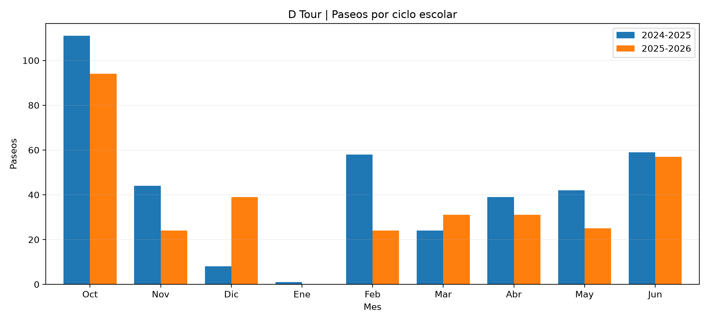
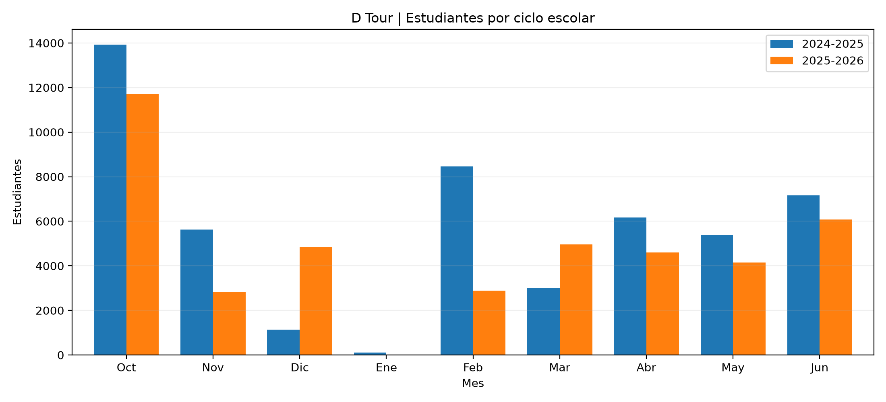
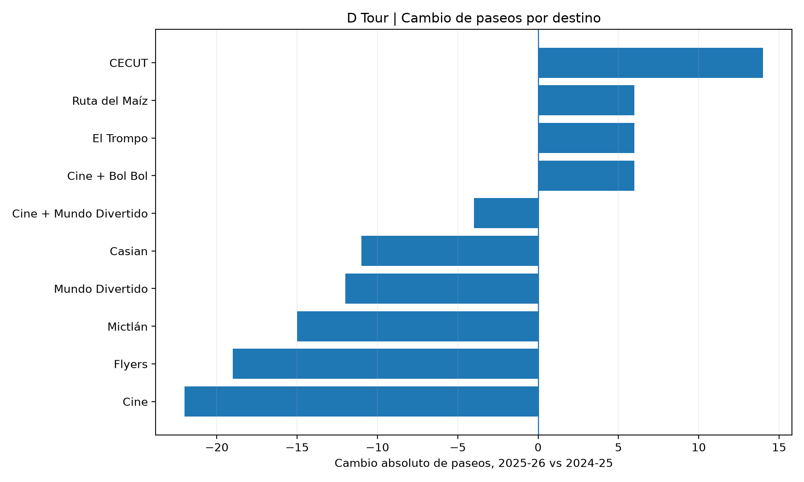
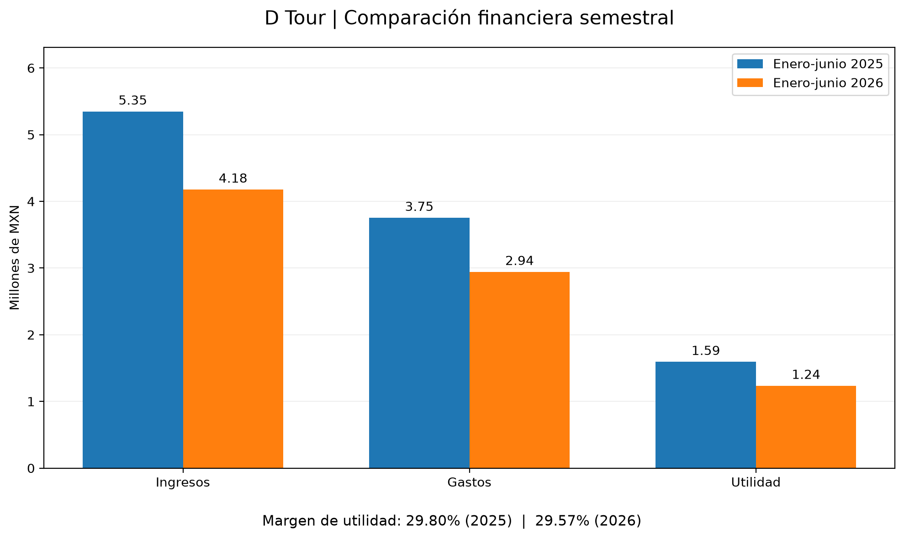

# D Tour | Operational & Financial Data Analytics

**A real-world business analytics case study using Python,
data validation, exploratory analysis, and financial reporting.**

[View the full case study](CASE_STUDY.md)

## Project Highlights

| Metric | Result |
|---|---|
| Operational records integrated | 1,129 |
| Trips confirmed as not performed | 74 |
| Preliminary decline in trip volume | -28.82% |
| Audited decline in trip volume | -15.80% |
| Change in reported accounting profit | -22.48% |

**Key insight:** Data quality validation substantially
changed the interpretation of business performance.

The preliminary and audited trip comparisons use the
October-June periods of the 2024-2025 and 2025-2026
school years. The profit comparison uses January-June
2025 versus January-June 2026.

## Business Context

D Tour is a family-owned educational field trip company
based in Tijuana, Mexico.

Operational and financial records were distributed across
historical Excel spreadsheets, Odoo project exports,
sales reports, and accounting records.

The objective was to transform fragmented information
into consistent, validated business indicators.

## Technical Approach

The internal project involved:

1. **Data auditing:** Evaluating source structures,
   missing values, inconsistencies, and invalid records.
2. **Data integration:** Combining Excel and Odoo data
   into a unified operational dataset.
3. **Data cleaning:** Standardizing dates, destinations,
   and service classifications.
4. **Data validation:** Investigating differences
   between processed records and historical references.
5. **Exploratory analysis:** Comparing school years,
   destination activity, and student participation.
6. **Financial analysis:** Evaluating revenue, expenses,
   accounting profit, and exploratory contribution margins.
7. **Reporting:** Translating findings into business
   insights while documenting analytical limitations.

The detailed internal notebooks and original
service-level records remain private.

## Key Business Findings

### 1. Data Quality Changed the Interpretation

The integrated dataset contained 1,129 service records.

A subsequent audit identified 74 trips confirmed
as not having taken place.

For the comparable October-June periods:

| Metric | 2024-2025 | 2025-2026 | Change |
|---|---:|---:|---:|
| Audited trips | 386 | 325 | -15.80% |
| Student participations | 51,017 | 42,051 | -17.57% |

Before the final audit, trip volume appeared to have
declined by 28.82%.

The audited decline was 15.80%, demonstrating the
importance of validating data before interpreting KPIs.

### 2. Destination Availability Influenced Comparisons

Two destinations experienced external restrictions
or temporary unavailability.

Excluding these destinations and associated packages,
trip volume declined by 7.16%, and student
participation declined by 9.51%.

This is a descriptive sensitivity analysis, not
evidence of a causal effect.

### 3. Accounting Profit Declined

For January-June 2025 versus January-June 2026:

- Revenue: -21.87%
- Reported accounting profit: -22.48%
- Accounting profit margin: 29.80% to 29.57%

The margin remained relatively stable despite
the decline in revenue and absolute profit.

The analysis assumes complete semester-level
expense recognition.

### 4. Revenue Does Not Equal Profitability

Exploratory contribution-margin scenarios indicated
differences across destinations.

However, project-level supplier costs were not
fully attributable to individual services.

The estimated margins are illustrative scenarios,
not audited or verified destination-level profitability.

See [CASE_STUDY.md](CASE_STUDY.md) for the methodology,
detailed results, and limitations.

## Exploratory Data Analysis (EDA)

The exploratory analysis examined seasonality, student
participation, and changes in destination demand across
two comparable school-year periods (October-June).

The analysis uses audited operational records, excluding
trips confirmed as not performed.

### 1. Monthly Trip Volume and Seasonality

Trip volume declined from **386 to 325 trips (-15.80%)**.

However, the decline was not uniform across months:

- October: 111 to 94 trips.
- December: 8 to 39 trips.
- February: 58 to 24 trips.
- May: 42 to 25 trips.
- June: 59 to 57 trips.

These differences illustrate the importance of
seasonality and monthly demand patterns.



### 2. Student Participation

Student participations declined from **51,017 to
42,051 (-17.57%)**.

These figures represent student-trip participations,
not necessarily distinct individual students.



### 3. Destination-Level Performance

Some destinations experienced declining activity,
while others increased their trip volume.

| Destination | 2024-2025 | 2025-2026 | Change |
|---|---:|---:|---:|
| Cine | 83 | 61 | -22 |
| Flyers | 20 | 1 | -19 |
| Mictlan | 51 | 36 | -15 |
| Mundo Divertido | 12 | 0 | -12 |
| Casian | 32 | 21 | -11 |
| CECUT | 69 | 83 | +14 |
| El Trompo | 45 | 51 | +6 |
| Ruta del Maiz | 32 | 38 | +6 |



### 4. Destination Availability Sensitivity

Flyers was affected by school-related restrictions,
while Mundo Divertido was temporarily unavailable
due to renovation.

Excluding these destinations and associated packages:

- Trip volume: 349 to 324 (-7.16%).
- Student participations: 46,327 to 41,919 (-9.51%).

This is a descriptive sensitivity analysis. It does
not establish causal effects or explain the entire
change in demand.

### 5. Reproducibility

The underlying monthly and destination-level
aggregates are publicly available in `data/aggregated/`.

The charts can be reproduced using:

```bash
python src/reproduce_operational_analysis.py
```

The confidential original records and the complete
exploratory notebook remain private.

## Financial Analysis Visualization

The financial analysis compares reported revenues,
expenses, accounting profit, and profit margins
between January-June 2025 and January-June 2026.



For detailed financial findings and methodological
limitations, see [CASE_STUDY.md](CASE_STUDY.md).

## Reproducible Public Analysis

The repository contains two complementary workflows:

**1. Synthetic pipeline demonstration**

Illustrates schema standardization, source integration,
data validation, exclusion rules, and aggregation using
fictional operational records.

**2. Real aggregated operational analysis**

Uses public, aggregated business data to reproduce
monthly operational comparisons and destination trends.

The aggregated datasets contain no individual
school or customer records.

### Installation

Requires Python 3.10 or newer.

```bash
git clone https://github.com/alejandrorivasr/dtour-business-data-analytics.git
cd dtour-business-data-analytics
python -m pip install -r requirements.txt
```

### Run Automated Tests

```bash
python -m unittest discover -s tests -v
```

### Run the Synthetic Demonstration

```bash
python src/demo_pipeline.py
```

### Reproduce the Real Operational Charts

```bash
python src/reproduce_operational_analysis.py
```

Generated results are saved under `reports/`.

## Repository Structure

```text
dtour-business-data-analytics/
├── README.md
├── CASE_STUDY.md
├── requirements.txt
├── data/
│   └── aggregated/
│       ├── monthly_operations.csv
│       └── destination_operations.csv
├── src/
│   ├── demo_pipeline.py
│   ├── validation.py
│   └── reproduce_operational_analysis.py
├── tests/
│   └── test_validation.py
└── reports/
    └── figures/
        ├── paseos_auditados.png
        ├── estudiantes_auditados.png
        ├── cambios_destinos_auditados.png
        └── comparacion_financiera_semestral.png
```

## Technologies

Python, pandas, NumPy, Matplotlib, Jupyter Notebook,
Excel, Odoo, Git, and GitHub.

## Scope and Limitations

- Original transactional data and the six internal
  analysis notebooks are not publicly distributed.
- Public operational summaries can reproduce selected
  analyses but not the original cleaning process.
- Financial results depend on private accounting data.
- Some historical row identifiers changed, although
  selected analytical fields passed content validation.
- Sales-to-project matching was incomplete.
- Destination contribution margins are estimates,
  not verified net profits.
- No causal or financial improvement attributable
  to this project has been established.

## Conclusion

This project demonstrates the practical application
of data engineering, data quality validation,
exploratory analytics, and financial analysis
to real operational challenges.

Its central contribution was establishing more
reliable business performance indicators and
supporting better-informed management decisions.
